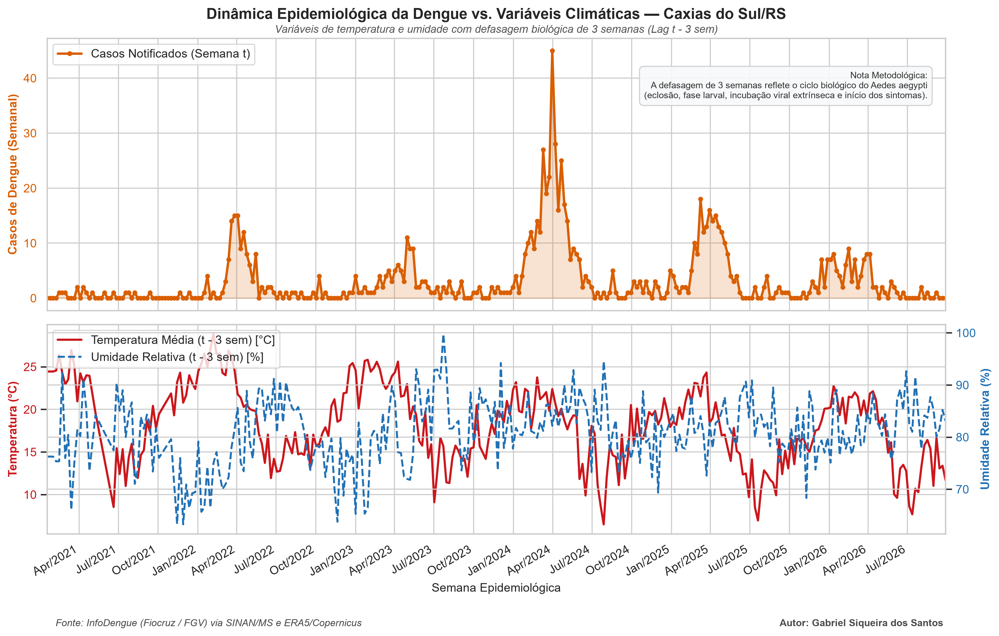

# Análise Epidemiológica: Dinâmica Climática e Incidência de Dengue em Caxias do Sul / RS

Este projeto analisa a influência das variáveis climáticas (temperatura média e umidade relativa do ar) na incidência de casos notificados de Dengue no município de **Caxias do Sul (RS)**, utilizando dados epidemiológicos e meteorológicos integrados.

# Contexto e Justificativa Técnica
O ciclo reprodutivo do vetor (*Aedes aegypti*) e o Período de Incubação Extrínseco (PIE) do vírus possuem forte dependência térmica e higrométrica. A literatura aponta faixas térmicas ótimas entre 25°C e 30°C e umidade relativa superior a 70%.

Na Serra Gaúcha, as baixas temperaturas no outono/inverno atuam como limitador natural da transmissão vetorial. Para capturar adequadamente a relação biológica entre clima e notificação clínica (fase larval, emergência de adultos alados, replicação viral e período de incubação no hospedeiro), aplicou-se uma **defasagem temporal (*lag*) de 3 semanas** (~21 dias) nas variáveis meteorológicas.

# Visualização dos Dados

# Tecnologias Utilizadas
- **Python 3**
- **Pandas**: Limpeza e tratamento de dados, interpolação de variáveis ambientais e engenharia de features (*lags* temporais).
- **Matplotlib & Seaborn**: Construção do painel visual multieixo e formatação de séries temporais por Semana Epidemiológica.

# Fontes de Dados
- **Notificações de Dengue:** SINAN / Ministério da Saúde via plataforma **InfoDengue (Fiocruz / FGV)**.
- **Variáveis Meteorológicas:** Reanálise climática ERA5 / Copernicus integrada pelo sistema InfoDengue.

**Autor:** Gabriel Siqueira dos Santos  
*Tecnólogo em Saneamento Ambiental | Análise de Dados*